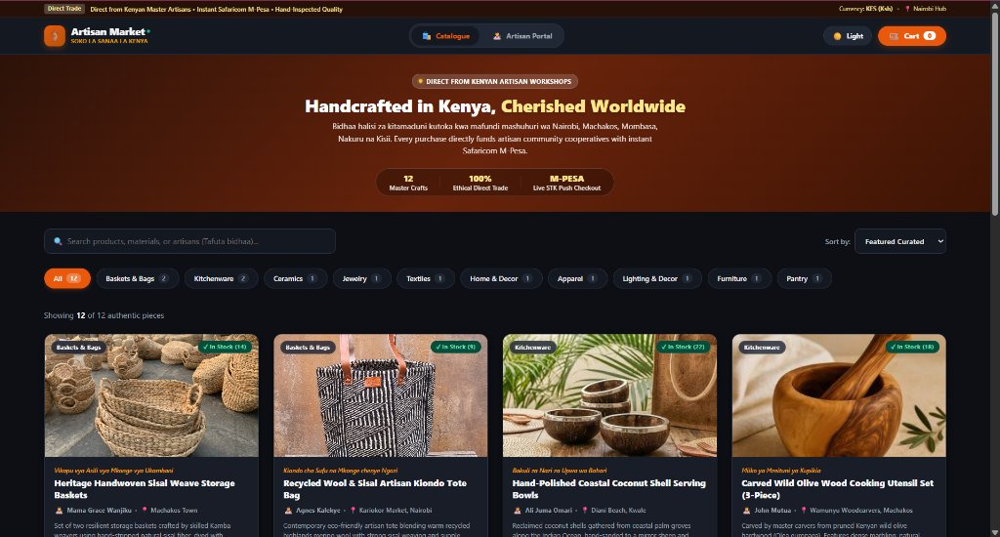
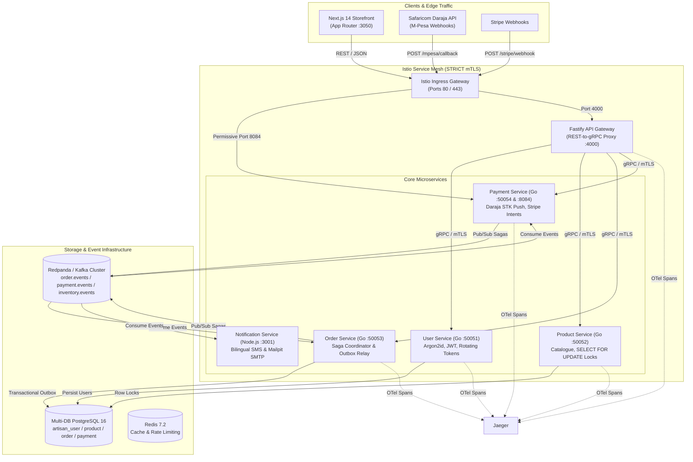
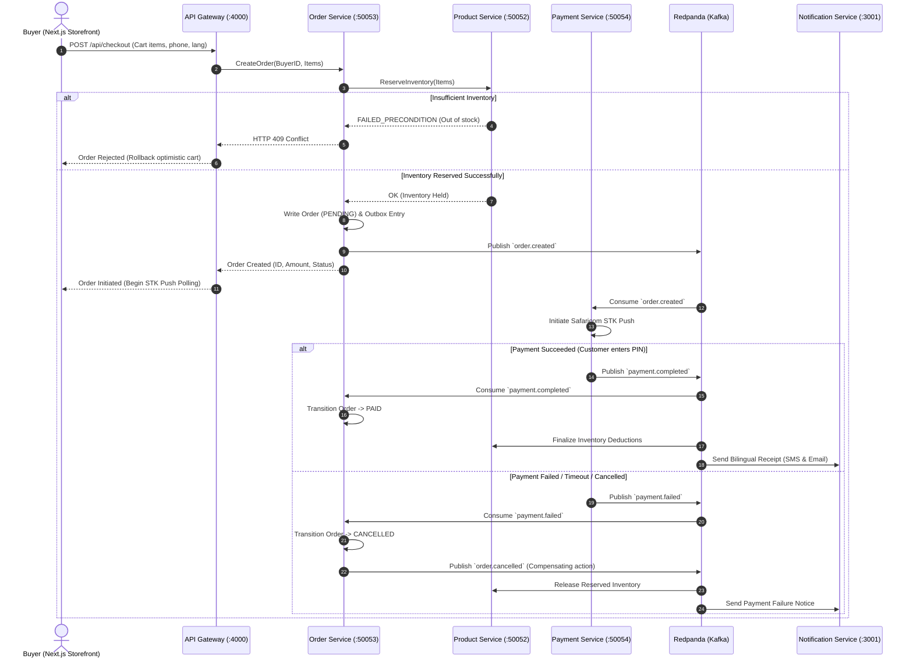

# Artisan Market — Enterprise Kenyan Microservices E-Commerce Platform

[](https://go.dev/)
[](https://nodejs.org/)
[](https://nextjs.org/)
[](https://protobuf.dev/)
[](https://buf.build/)
[](https://redpanda.com/)
[](https://www.postgresql.org/)
[](https://istio.io/)
[](https://opentelemetry.io/)
[](https://github.com/crnjihia/artisan-market)
[](LICENSE)

> **Architected & Engineered by Christopher Njihia (Nairobi, Kenya)**  
> *A production-grade, portfolio-grade distributed microservices e-commerce platform engineered specifically for authentic African craftspeople, sculptors, and textile artisans. Features distributed sagas with transactional outbox, Safaricom Daraja M-Pesa STK push, bilingual Swahili/English localization, STRICT Istio mTLS, and OpenTelemetry distributed tracing.*

---

<p align="center">
  
</p>

---

## 1. Executive Summary & Problem Context

In Kenya and across East Africa, traditional craftspeople (from Kisii soapstone sculptors to Machakos sisal weavers and Kitui olive wood carvers) face structural hurdles when trading in global digital marketplaces:
- **Mobile Money Fragmentation**: Over 85% of retail e-commerce in Kenya relies on Safaricom M-Pesa rather than international credit cards.
- **High-Concurrency Race Conditions**: Limited-edition handmade artisan drops frequently trigger overselling inventory races under sudden traffic spikes.
- **Network Volatility & Dropped Callbacks**: Transient mobile connectivity often causes dropped payment webhooks and inconsistent distributed order states.
- **Local Developer Friction**: Sandboxes requiring external public tunnels (`ngrok`) impede rapid, reliable offline development and automated CI.

**Artisan Market** is a cloud-native microservices solution built to resolve these exact challenges:
* **High-Throughput Backends**: Go 1.24 gRPC microservices with Protobuf v3 (Buf v2 Standard).
* **Distributed Sagas & Outbox**: Asynchronous choreography with Redpanda Kafka, transactional outbox (`SELECT FOR UPDATE SKIP LOCKED`), and idempotent event consumers.
* **Dual Payment Gateways**: Safaricom Daraja M-Pesa STK Push with real-time polling alongside Stripe PaymentIntents.
* **Modern Frontend**: Next.js 14 App Router, bilingual EN/SW interface, 4x3 fluid responsive grid (spanning 95% viewport width), and a built-in Dark/Light theme engine.
* **Zero-Trust Security**: Mutual TLS (mTLS) with Istio service mesh, Argon2id password hashing, and rotating JWT refresh tokens.

---

## 2. High-Level System Architecture



---

## 3. Microservices Catalogue & Ports

| Service | Language / Framework | Protocol | Ports | Database | Primary Responsibility |
| :--- | :--- | :--- | :--- | :--- | :--- |
| **API Gateway** | Node.js 20 / Fastify | REST $\leftrightarrow$ gRPC | `4000` | Redis (Rate limits) | REST-to-gRPC dynamic routing, JWT auth, input validation |
| **User Service** | Go 1.24 | gRPC (Buf v2) | `50051` | `user_db` | Argon2id password hashing, rotating refresh tokens, profiles |
| **Product Service** | Go 1.24 | gRPC (Buf v2) | `50052` | `product_db` | Catalogue CRUD, row-level locks preventing overselling |
| **Order Service** | Go 1.24 | gRPC + Kafka | `50053` | `order_db` | Distributed saga coordinator, transactional outbox relay |
| **Payment Service** | Go 1.24 | gRPC + HTTP | `50054`, `8084` | `payment_db`| Safaricom Daraja STK push, Stripe webhooks, outbox |
| **Notification** | Node.js 20 / TypeScript | Kafka Consumer | `3001` | Mailpit (Dev SMTP) | Bilingual SMS (Africa's Talking), Mailpit email, DLQ |
| **Storefront** | Next.js 14 App Router | React / CSS | `3050` (web) | N/A | 4x3 desktop grid, dark mode engine, cart drawer, M-Pesa modal |

---

## 4. Distributed Checkout Saga & Compensation Workflow

Artisan Market implements a **Domain-Orchestrated Hybrid Saga** coordinated by the Order Service with asynchronous Kafka choreography:



### Transactional Outbox Pattern
To prevent dual-write anomalies between PostgreSQL and Kafka, all state transitions write an event to an `outbox` table within the same ACID transaction:
```sql
-- Atomically writes business aggregate and event record
INSERT INTO orders (id, buyer_id, total_cents, status) VALUES (...);
INSERT INTO outbox (id, aggregate_type, aggregate_id, event_type, payload) VALUES (...);
```
An asynchronous background relay polls the outbox using PostgreSQL's `FOR UPDATE SKIP LOCKED` to publish events to Redpanda with zero message loss.

---

## 5. Key Engineering Features

### 1. Dual Payment Gateways & Offline Simulation
- **Safaricom Daraja M-Pesa STK Push**: Normalizes Kenyan phone numbers (`07...`, `+254...`, `01...`), formats timestamps in East Africa Time (`YYYYMMDDHHmmss`), generates base64 passwords, and triggers instant mobile prompts.
- **100% Credential-Free Mock Mode**: Setting `USE_MOCKS=true` simulates instant STK pushes, background callback webhooks, and live status polling without requiring live Safaricom API credentials or public tunnels (`ngrok`).
- **Stripe PaymentIntents**: Automatic conversion from integer cents to KES currency, generating client secrets for debit/credit card checkouts.

### 2. High-Concurrency Inventory Protection
- Product inventory reservations utilize PostgreSQL row-level locks (`SELECT inventory FROM products WHERE id = $1 FOR UPDATE`).
- Fully immune to race conditions during simultaneous viral flash drops across artisan cooperatives.

### 3. OpenTelemetry Distributed Tracing & RED Metrics
- W3C TraceContext propagation across **gRPC metadata**, **HTTP headers**, and **Kafka binary headers**.
- RED Metrics (Rate, Errors, Duration) collected for every gRPC procedure and exported to Jaeger (`http://localhost:16686`).

### 4. Zero-Trust Security & Istio Service Mesh
- STRICT Mutual TLS (mTLS) enforcement across internal Kubernetes service-to-service communication.
- Selective permissive ingress for public webhooks on port `8084` (`/mpesa/callback`, `/stripe/webhook`).
- Password security via Argon2id with cryptographically random 16-byte salts and rotating refresh tokens stored as SHA-256 hashes.

### 5. Bilingual Kenyan Localization
- Bilingual notification engine in English and Kiswahili (`en` / `sw`).
- Contextual templates for order confirmation, artisan payout notification, and shipment dispatch.

---

## 6. Project Layout

```
artisan-market/
├── .github/workflows/          # GitHub Actions CI/CD (CI, Packages, Releases, Deploy)
│   ├── ci.yml                  # Go + Node linting, Buf lint, and automated test suites
│   ├── packages.yml            # OCI container image builds & GHCR publishing
│   ├── release.yml             # Cross-compiled binaries, checksums & GitHub Releases
│   ├── deploy.yml              # Kubernetes Kustomize continuous deployment
│   └── e2e.yml                 # Playwright end-to-end checkout automation
├── backend/
│   ├── common/                 # Shared telemetry (OTel), mTLS security, and middleware
│   ├── gateway/                # Fastify REST-to-gRPC proxy, JWT validation, OpenAPI spec
│   ├── user/                   # Go gRPC user service, Argon2id, rotating tokens
│   ├── product/                # Go gRPC product service, row locks, inventory CRUD
│   ├── order/                  # Go gRPC order service, saga orchestrator, outbox relay
│   ├── payment/                # Go gRPC payment service, Daraja STK Push & Stripe adapters
│   └── notification/           # TypeScript Kafka consumer, SMS (Africa's Talking) & Email
├── deploy/
│   └── k8s/                    # Production Kubernetes manifests & Kustomize overlays
│       ├── istio/              # VirtualServices, DestinationRules, Canary 90/10 routing
│       ├── security/           # Istio PeerAuthentication & AuthorizationPolicies
│       └── services/           # Deployments, Services, ConfigMaps for all 7 microservices
├── docs/
│   ├── adr/                    # Architecture Decision Records (ADR 001 - 004)
│   ├── assets/                 # Architecture diagrams, UI screenshots
│   ├── observability.md        # OpenTelemetry tracing & Jaeger runbook
│   ├── runbook.md              # SRE production incident runbook & escalation matrix
│   └── security.md             # Threat model, mTLS architecture, RBAC policies
├── frontend/                   # Next.js 14 App Router, Dark Mode, 4x3 fluid grid
├── proto/                      # Protobuf v3 schemas managed with Buf v2
├── scripts/                    # PowerShell & Bash automation scripts
│   ├── launch-all.ps1          # One-click multi-tab developer stack launcher
│   ├── run-all-tests.ps1       # Master test suite runner (Unit, Saga E2E, Contracts)
│   ├── seed-data.sql           # Database seed with 12 authentic Kenyan artisan items
│   └── generate-certs.go       # Cross-platform development mTLS certificate generator
└── docker-compose.yml          # Postgres 16, Redis 7.2, Redpanda Kafka, Jaeger, Mailpit
```

---

## 7. Quick Start (Run Locally)

### Prerequisites
- [Go 1.24+](https://go.dev/dl/)
- [Node.js 20+ LTS](https://nodejs.org/)
- [Docker Desktop](https://www.docker.com/products/docker-desktop/) (v24+)

### Option A: One-Click Windows Launcher (Recommended)
Launch the entire platform (all 5 backing containers + all 7 microservices) in dedicated tabs:
```powershell
.\scripts\launch-all.ps1
```

### Option B: Step-by-Step Manual Launch

#### Step 1: Start Backing Infrastructure
```bash
docker compose up -d
```
Verify all 5 services are healthy (`artisan-postgres`, `artisan-redis`, `artisan-redpanda`, `artisan-jaeger`, `artisan-mailpit`).

#### Step 2: Generate Development mTLS Certificates
```bash
go run scripts/generate-certs.go
```

#### Step 3: Seed Products into Database
```powershell
Get-Content scripts/seed-data.sql | docker exec -i artisan-postgres psql -U postgres -d product_db
```

#### Step 4: Start Platform Services
Run each service in a separate terminal:
```bash
# Go Microservices
cd backend/user && go run .
cd backend/product && go run .
cd backend/order && go run .
cd backend/payment && go run .

# Node.js & TypeScript Services
npm --prefix backend/notification run dev
npm --prefix backend/gateway run dev

# Next.js 14 Storefront
npm --prefix frontend run dev
```

---

## 8. Developer Consoles & Local URLs

| Application / Console | URL | Description |
| :--- | :--- | :--- |
| **Next.js Storefront** | **[http://localhost:3050](http://localhost:3050)** | Handcrafted Kenyan marketplace, cart drawer, M-Pesa modal |
| **API Gateway Health** | **[http://localhost:4000/api/health](http://localhost:4000/api/health)** | Fastify REST-to-gRPC gateway health status |
| **Mailpit Web UI** | **[http://localhost:8025](http://localhost:8025)** | Real-time inspection of transactional emails & SMS notifications |
| **Jaeger Tracing Web UI** | **[http://localhost:16686](http://localhost:16686)** | Distributed trace viewer across gRPC, HTTP, and Kafka |
| **Redpanda Kafka Console** | **[http://localhost:8081](http://localhost:8081)** | Event topics, partitions, and schema registry |

---

## 9. Automated Testing & Verification

The repository features comprehensive automated test suites covering contract schemas, unit logic, and end-to-end distributed sagas:

```powershell
# Run all automated tests (52/52 passing)
.\scripts\run-all-tests.ps1
```

| Test Suite | Location | Tests | Status |
| :--- | :--- | :--- | :--- |
| **User Service Unit** | `backend/user/server_test.go` | 8 | PASS |
| **Product Service Unit** | `backend/product/server_test.go` | 6 | PASS |
| **Order Service Unit** | `backend/order/server_test.go` | 6 | PASS |
| **Payment Service Unit** | `backend/payment/server_test.go` | 7 | PASS |
| **Gateway REST API** | `backend/gateway/src/__tests__/` | 5 | PASS |
| **Notification Consumer** | `backend/notification/src/__tests__/`| 5 | PASS |
| **Common mTLS & OTel** | `backend/common/...` | 5 | PASS |
| **Protobuf Contract Tests** | `tests/contract_test.go` | 6 | PASS |
| **Distributed Saga E2E** | `backend/order/saga_e2e_test.go` | 4 | PASS |
| **Total Automated Tests** | | **52 / 52** | **100% PASS** |

---

## 10. Kubernetes & Istio Production Deployment

Render and apply the production manifest tree via Kustomize:

```bash
# Preview rendered Kubernetes manifests
kubectl kustomize deploy/k8s

# Apply to cluster
kubectl apply -k deploy/k8s

# Verify STRICT mTLS enforcement
istioctl authn tls-check $(kubectl get pod -l app=order -o jsonpath='{.items[0].metadata.name}')
```

Canary deployments are pre-configured in `deploy/k8s/istio/canary-example.yaml` to route 90% of traffic to `v1` (baseline) and 10% to `v2` (canary) with automated rollback triggers.

---

## 11. CI/CD GitHub Actions Workflows

Automated continuous integration and deployment pipelines are located in `.github/workflows/`:

* **`ci.yml`**: Runs on every pull request and push to `main`. Validates Go 1.24 formatting and tests, Node.js linting, Buf v2 Protobuf linting, and contract compatibility.
* **`packages.yml`**: Builds and publishes multi-architecture OCI container images (`linux/amd64`, `linux/arm64`) to GitHub Container Registry (`ghcr.io/crnjihia/artisan-market/*`).
* **`release.yml`**: Triggers on version tags (`v*`). Cross-compiles Go binaries, generates SHA-256 checksums, and publishes formal GitHub Releases.
* **`deploy.yml`**: Automated continuous deployment to staging and production Kubernetes clusters via Kustomize image updates.

---

## 12. License & Author Attribution

Distributed under the **MIT License**. See [`LICENSE`](LICENSE) for complete details.

**Author**: Christopher Njihia  
**Location**: Nairobi, Kenya  
**GitHub**: [@crnjihia](https://github.com/crnjihia)  
**Project Repository**: [https://github.com/crnjihia/artisan-market](https://github.com/crnjihia/artisan-market)
