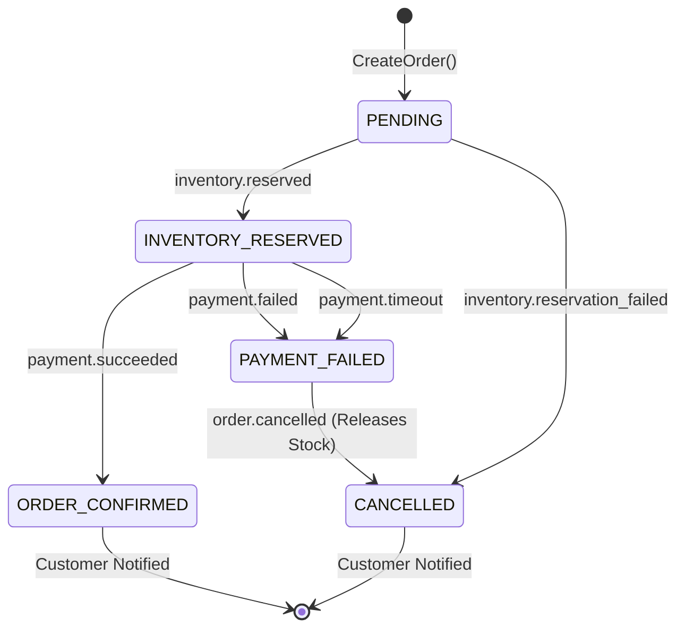

# path: docs/adr/002-saga-choreography-vs-orchestration.md
# ADR 002: Distributed Saga Coordination Strategy (Choreography vs Orchestration)

- **Status**: Accepted
- **Date**: 2026-11-06
- **Author**: Christopher Njihia (Nairobi, Kenya)
- **Scope**: Checkout distributed transaction across `order`, `product`, `payment`, and `notification` services

---

## 1. Context and Problem Statement

When a buyer checks out on Artisan Market, the checkout process spans four microservices:
1. `order`: Persists order aggregate in PostgreSQL.
2. `product`: Reserves stock using PostgreSQL row-level locks (`SELECT ... FOR UPDATE`) to prevent overselling.
3. `payment`: Initiates and processes Safaricom M-Pesa Daraja STK Push or Stripe PaymentIntent.
4. `notification`: Sends bilingual SMS (Africa's Talking) and email (Mailpit/SMTP) order confirmations.

Because each service owns its private database, distributed transactions must follow the Saga pattern. If any step fails (e.g., M-Pesa PIN cancelled by customer, insufficient mobile money balance, or inventory exhaustion), the system must execute compensating transactions to restore invariants (e.g. releasing reserved inventory and marking the order as cancelled).

The fundamental question is whether to adopt:
- **Pure Choreography**: Each service listens to events and independently decides when to act without a central coordinator.
- **Centralized Orchestrator**: An external orchestration engine (such as Camunda, Temporal, or AWS Step Functions) that commands each service.
- **Domain-Orchestrated Hybrid**: The `order` service acts as the lightweight saga coordinator, while services interact asynchronously over Kafka topics.

---

## 2. Decision Drivers

- **Observability & Traceability**: Clear, queryable state machine for every customer order.
- **Decoupling**: Services must retain clean domain boundaries without circular dependencies.
- **Failure Transparency & Compensation**: Immediate detection of payment rejections or timeouts with automatic inventory release.
- **Architectural Simplicity**: No external workflow server infrastructure; pure Go implementation.

---

## 3. Comparison of Alternatives

| Criteria | Pure Choreography | External Orchestrator (Temporal) | Domain-Orchestrated Hybrid |
| :--- | :--- | :--- | :--- |
| **Visibility** | Low (scattered across events) | High (centralized dashboard) | High (`orders.saga_step` column + OTel) |
| **Coupling** | Risk of cyclic event dependencies | Services coupled to workflow engine | Loosely coupled via standard Kafka topics |
| **Infrastructure** | Zero extra tools | Extra cluster/database for orchestrator | Zero extra tools (runs in Go service) |
| **Compensations** | Difficult to trace who compensates | Rigid linear task definitions | Explicit compensating events (`order.cancelled`) |

---

## 4. Decision Outcome

Chosen Option: **Domain-Orchestrated Hybrid (Order Service as Coordinator)**.

### State Machine Specification

The `order` service persists the explicit saga state machine in its `orders` table:
- `PENDING`: Order recorded; awaiting inventory reservation.
- `INVENTORY_RESERVED`: Product service confirmed stock locks; order service emits `payment.requested`.
- `INVENTORY_FAILED`: Stock insufficient; order automatically moves to `cancelled`.
- `ORDER_CONFIRMED`: Safaricom M-Pesa STK push or Stripe succeeded; outbox emits `order.confirmed` -> notification sent.
- `PAYMENT_FAILED`: Customer entered incorrect PIN, cancelled STK prompt, or lacked funds; triggers compensating transaction:
  - Coordinator emits `order.cancelled`.
  - Product service consumes `order.cancelled` and calls `ReleaseInventory(order_id)`.
  - Notification service alerts customer of failed payment with retry instructions.
- `PAYMENT_TIMEOUT`: Safaricom Daraja STK push timed out (>60 seconds); executes identical compensation rollback as `PAYMENT_FAILED`.

---

## 5. Consequences

### Positive
- **Deterministic Tracking**: Querying `SELECT status, saga_step FROM orders WHERE id = ?` immediately surfaces the exact distributed checkpoint.
- **Clean Compensations**: The compensation logic is isolated to explicit domain events (`order.cancelled` payload specifying `reason: payment_failure_or_timeout`), triggering row-level stock restoration in `product` service.
- **End-to-End Tracing**: OpenTelemetry trace context is injected into Kafka record headers (`traceparent`), connecting gRPC entry, outbox relay, saga consumers, and notification dispatches into a single distributed trace DAG in Jaeger.

### Negative & Mitigations
- **Coordinator Load**: High checkout volumes place state transitions on `order-service`. *Mitigation*: The service is horizontally scalable in Kubernetes (2+ replicas with Istio load balancing) and outbox polling uses `SKIP LOCKED`.

