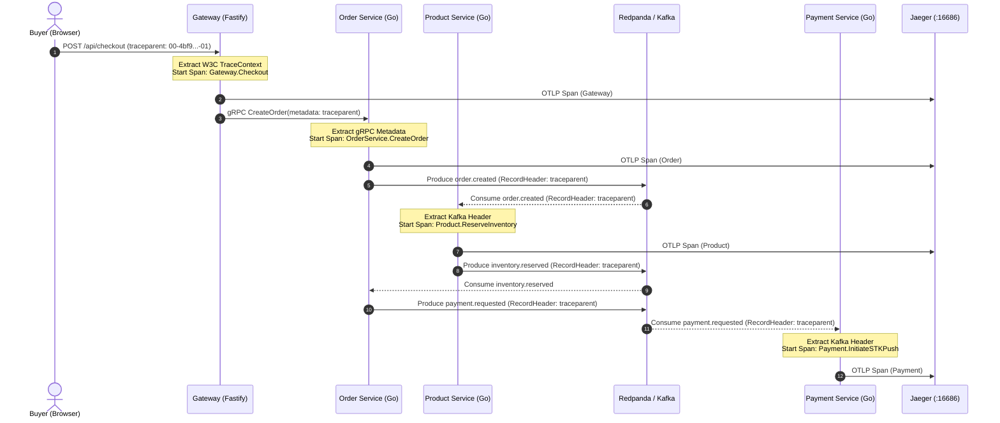

// path: docs/observability.md
# Observability & Distributed Tracing Guide

This guide documents the OpenTelemetry distributed tracing architecture, context propagation standards, Jaeger visualization, and RED metrics (Rate, Errors, Duration) for **Artisan Market** (`artisan-market`).

---

## 1. End-to-End Distributed Tracing Architecture

Artisan Market implements W3C TraceContext context propagation across HTTP, gRPC, and Kafka brokers, ensuring that a single trace spans the complete lifecycle of an order:



---

## 2. Context Propagation Standards

### 2.1 W3C TraceContext Specification
All services adhere to the standard `traceparent` header format:
```
00-{4bf92f3577b34da6a3ce929d0e0e4736}-{00f067aa0ba902b7}-{01}
^^  ^^^^^^^^^^^^^^^^^^^^^^^^^^^^^^^^    ^^^^^^^^^^^^^^^^    ^^
ver Trace ID (16 bytes hex)             Span ID (8 bytes)   Flags (sampled)
```

### 2.2 Transport Layers
1. **HTTP (Browser & REST Gateway)**:
   - Input: Inbound `traceparent` or generated on ingress.
   - Output: Response headers `traceparent` and `x-trace-id` returned to client.
2. **gRPC (Gateway & Internal Microservices)**:
   - Propagated via `metadata.MD` using `MetadataCarrier` (`backend/common/telemetry/grpc.go`).
   - Standard Unary client and server interceptors automatically inject and extract trace contexts.
3. **Kafka (Saga Event Choreography)**:
   - Propagated through `kgo.RecordHeader` using `KafkaRecordHeaderCarrier` (`backend/common/telemetry/kafka.go`).
   - Consumer spans link directly to the transaction originator.

---

## 3. Jaeger Distributed Tracing UI

### 3.1 Accessing Jaeger
When running via Docker Compose (`make up`), Jaeger is accessible at:
- **Web UI**: `http://localhost:16686`
- **OTLP gRPC Ingestion**: `localhost:4317`
- **OTLP HTTP Ingestion**: `localhost:4318`

### 3.2 Finding Traces
In the Jaeger UI:
1. Select **Service**: `gateway`, `order`, or `payment`.
2. Select **Operation**: e.g., `OrderService.CreateOrder` or `Gateway.RouteCheckout`.
3. Filter by Tags:
   - `order_id`: Filter specific checkout transactions.
   - `payment_method`: `mpesa` or `stripe`.
   - `error`: `true` to view saga compensation paths.

---

## 4. RED Metrics Standard (Rate, Errors, Duration)

All Go services record standard Prometheus RED metrics exposed on `/metrics`:

### 4.1 Rate (Requests / Operations per Second)
```promql
# Rate of checkout requests handled by the order service
sum(rate(artisan_requests_total{service="order-service", operation="CreateOrder"}[1m]))
```

### 4.2 Errors (Failed Operations)
```promql
# Error rate by service and operation
sum(rate(artisan_errors_total{status="error"}[1m])) by (service, operation)
```

### 4.3 Duration (Latency Distribution)
```promql
# 95th percentile latency in seconds
histogram_quantile(0.95, sum(rate(artisan_request_duration_seconds_bucket[5m])) by (le, service, operation))
```

---

## 5. Running the Telemetry Verification Suite

```bash
cd backend/common/telemetry
go test -tags purego -v ./... -count=1
```

