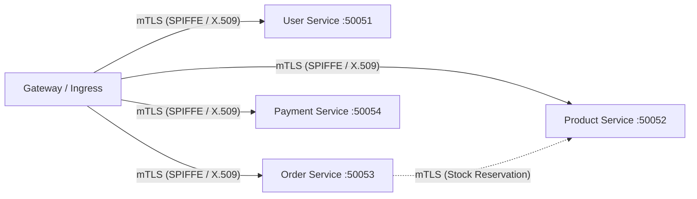

// path: docs/security.md
# Security Architecture & Secrets Management

This document details the security posture, cryptographic identity, mutual TLS (mTLS), access controls, and secrets management implementation for **Artisan Market** (`artisan-market`).

---

## 1. Zero-Trust Identity & Transport Security (mTLS)

Artisan Market enforces a Zero-Trust network architecture across all inter-service communications:

### 1.1 Local Development Environment
In local development and Docker Compose, mTLS is established using an ephemeral Root CA and per-service X.509 keypairs:
- **Root CA**: Generated via `scripts/generate-dev-certs.sh` or `scripts/generate-certs.go` (`certs/ca.crt`, `certs/ca.key`).
- **SAN Validation**: Certificates include Subject Alternative Names for `localhost`, `127.0.0.1`, and service DNS names (e.g. `user`, `product`, `order`, `payment`).
- **Mutual Verification**: Server instances enforce `tls.RequireAndVerifyClientCert`. Any client connection without a valid certificate signed by the Root CA is dropped during the TLS 1.3 handshake.

### 1.2 Kubernetes & Istio Service Mesh
In production Kubernetes clusters:
- Istio Citadel automatically issues short-lived SPIFFE X.509 certificates to each pod.
- `PeerAuthentication` enforces `STRICT` mode across the `artisan-market` namespace (`deploy/k8s/security/peer-authentication.yaml`).
- Port 8084 on the payment service maintains `PERMISSIVE` mode to accept incoming HTTPS webhooks from external Safaricom Daraja and Stripe callbacks.

---

## 2. Least-Privilege Authorization Policies

Network connectivity alone does not grant access. Istio `AuthorizationPolicy` manifests enforce fine-grained RBAC:

| Target Service | Port | Permitted Principals (SPIFFE SA) | Enforced Policy |
|---|---|---|---|
| `gateway` | `4000` | `istio-ingressgateway-service-account` | Ingress only |
| `user` | `50051` | `gateway-sa` | User authentication & profiles |
| `product` | `50052` | `gateway-sa`, `order-sa` | Catalogue browsing & inventory lock |
| `order` | `50053` | `gateway-sa` | Checkout & order state machine |
| `payment` | `50054` | `gateway-sa` | STK push initiation & payment query |
| `payment` | `8084` | `istio-ingressgateway-service-account` | `POST /mpesa/callback`, `POST /stripe/webhook` |
| **All Others** | * | * | **DENY ALL** default rule |

---

## 3. Secrets Handling & Credential Lifecycle

### 3.1 Secrets Storage Hierarchy
1. **Local Development**: Configured strictly via environment variables (`.env.example`).
2. **Production / Staging**: Injected at runtime via Kubernetes Secrets backed by HashiCorp Vault or AWS Secrets Manager with KMS envelope encryption. Secrets are never checked into git.

### 3.2 External Provider Credentials
- **Safaricom Daraja API**:
  - `DARAJA_CONSUMER_KEY`, `DARAJA_CONSUMER_SECRET`: Used for OAuth token exchange.
  - `DARAJA_PASSKEY`: Used for Base64 password hashing (`ShortCode + Passkey + Timestamp`).
- **Stripe**:
  - `STRIPE_SECRET_KEY`: Restricted key with write access to `PaymentIntents` only.
  - `STRIPE_WEBHOOK_SECRET`: Used for HMAC-SHA256 signature verification over incoming payloads.
- **Africa's Talking**:
  - `AFRICA_TALKING_API_KEY`, `AFRICA_TALKING_USERNAME`.
- **Zero-Credential Isolation**:
  - Setting `USE_MOCKS=true` activates deterministic, offline simulation engines for Daraja, Stripe, and Africa's Talking. Local development, unit tests, and CI pipelines run end-to-end with zero real credentials.

---

## 4. PII Protection & Kenyan Regulatory Alignment

### 4.1 Kenyan Data Protection Act (DPA 2019)
- **Customer Phone Numbers**: Validated strictly against Kenyan prefixes (`+2547...`, `+2541...`). Mobile numbers are treated as Personal Identifiable Information (PII) and are never printed in application debug logs.
- **M-Pesa PINs**: Never collected, handled, or transmitted by Artisan Market. PIN entry occurs exclusively within Safaricom's SIM Application Toolkit (STK Push) on the buyer's physical mobile handset.

### 4.2 Credential Protection & Cryptographic Hashing
- **Argon2id Password Hashing**: Passwords in the `user` service are hashed using `argon2id` with `time=3`, `memory=64MB`, `parallelism=2` and cryptographically secure random salts.
- **Rotating Refresh Tokens**: Refresh token strings are never stored in plaintext. The database only retains the SHA-256 hash of the refresh token.
- **Short-Lived Access Tokens**: JWT access tokens have a validity of 15 minutes and require HMAC-SHA256 signature verification.

